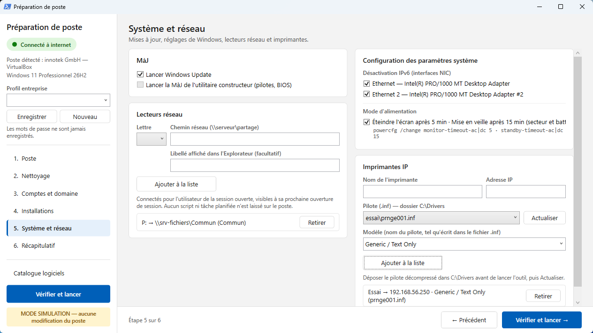
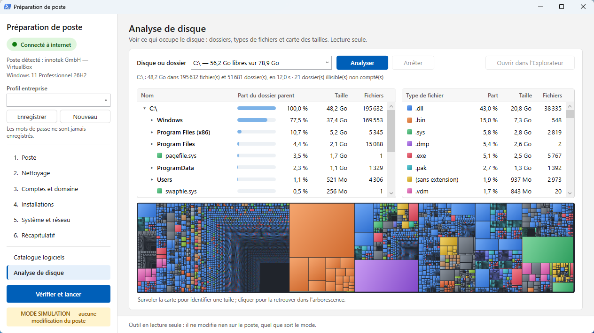

# FastPrepare — préparer un poste Windows 11 en une seule passe

[](https://github.com/bulssh/FastPrepare-windows/actions/workflows/ci.yml)

FastPrepare est un outil pour technicien : lancé depuis une clé USB sur un poste Windows 11 neuf, il
enchaîne tout ce qui se fait d'habitude à la main avant de remettre le poste à son utilisateur —
nettoyage des logiciels préinstallés, installation d'Office et des logiciels, comptes, domaine,
lecteurs réseau, imprimantes, mises à jour.

Le technicien suit cinq étapes dans une fenêtre, relit la liste des actions, clique sur **Lancer**,
puis lit le journal. Rien d'autre à installer : l'outil n'utilise que ce que Windows fournit déjà
(Windows PowerShell 5.1, WPF, winget).



## Sommaire

- [Ce que fait l'outil](#ce-que-fait-loutil)
- [Ce qu'il ne fait pas](#ce-quil-ne-fait-pas)
- [Garanties](#garanties)
- [Utilisation](#utilisation)
- [Profils entreprise](#profils-entreprise)
- [Analyse de disque](#analyse-de-disque)
- [Adapter l'outil à un parc](#adapter-loutil-à-un-parc)
- [État du projet](#état-du-projet)
- [Développement](#développement)

## Ce que fait l'outil

Chaque ligne est une case à cocher ou un champ à remplir : seules les actions demandées sont exécutées.

| Étape | Ce qu'on y règle |
|---|---|
| **1. Poste** | Rappel du renommage (signale un poste qui porte encore le nom donné par Windows) ; relevé du numéro de série et des adresses MAC, exporté dans un fichier et copiable d'un clic |
| **2. Nettoyage** | Désinstallation des logiciels préinstallés (silencieuse quand c'est possible, sinon l'assistant du logiciel) ; retrait d'Office, du nouvel Outlook, de OneNote, de Teams et de OneDrive ; suppression de sessions locales avec leur profil |
| **3. Comptes et domaine** | Création d'une ou plusieurs sessions locales (groupe, description, options du mot de passe) ; jonction à un domaine Active Directory, avec un bouton **Tester** qui vérifie le domaine et le compte sans rien modifier |
| **4. Installations** | Utilitaire du constructeur (Dell, HP, Lenovo, Fujitsu), proposé d'après la marque du poste ; Office (Microsoft 365 avec ou sans Teams, LTSC 2024, 2019) ; logiciels du catalogue ; agent RMM et antivirus à partir du lien fourni par leur console |
| **5. Système et réseau** | Windows Update et mise à jour des pilotes et du BIOS par l'utilitaire constructeur ; désactivation d'IPv6 par carte ; délais d'extinction de l'écran et de mise en veille ; lecteurs réseau ; imprimantes IP |
| **6. Récapitulatif** | Liste exacte des actions qui vont être faites, points à corriger, journal en direct, et le seul bouton **Lancer** |

Deux pages restent à part du parcours :

- **Catalogue logiciels** — les logiciels proposés à l'étape Installations. On en ajoute un par son
  paquet winget ou par un lien direct (`.exe`, `.msi`), on le **teste sans rien télécharger ni
  installer**, puis on l'enregistre sur la clé. Catalogue de départ : Adobe Acrobat Reader, Google
  Chrome, Mozilla Firefox, 7-Zip, Claude.
- **Analyse de disque** — voir ce qui occupe un disque ([détails plus bas](#analyse-de-disque)).

<details>
<summary>Détail de quelques fonctions</summary>

- **Désinstallations** : l'outil reconnaît les installateurs MSI, Inno Setup et NSIS pour les
  désinstaller sans fenêtre ; les autres ouvrent leur assistant, en dernier. Il attend que le
  logiciel ait réellement disparu avant de conclure.
- **Office** : installé et retiré par l'outil de déploiement de Microsoft (ODT), dont la
  signature est vérifiée ; le fichier de configuration est généré à la volée et recopié au journal.
- **Agent RMM et antivirus** : coller le lien de la console (NinjaOne, Datto RMM, Bitdefender,
  ESET) ; l'outil reconnaît l'installateur, le télécharge, exige une signature valide et l'installe
  en silencieux. Un installateur d'antivirus non reconnu est refusé plutôt que lancé au hasard.
- **Lecteurs réseau** : connectés de façon persistante pour l'utilisateur de la session ouverte,
  visibles à sa prochaine ouverture de session, sans script ni tâche planifiée laissés sur le poste.
- **Imprimantes IP** : déposer le pilote décompressé dans `C:\Drivers`, choisir son fichier `.inf`
  et le modèle ; le pilote et le port sont réutilisés s'ils existent déjà.
- **winget** : s'il manque ou si sa source est inutilisable sur le compte qui lance l'outil,
  l'outil le réenregistre ou le répare seul, et le signale dès le démarrage.

</details>

## Ce qu'il ne fait pas

Ces actions restent **à la main**, et l'outil les rappelle dans son rapport final :

- le **renommage du poste**, suivi d'un redémarrage, avant de lancer l'outil ;
- le chiffrement **BitLocker** ;
- la **connexion du compte Microsoft 365** ;
- le **redémarrage final**.

## Garanties

- **Simulation par défaut.** L'outil s'ouvre en simulation : il déroule tout le parcours et écrit au
  journal ce qu'il ferait, sans rien modifier. Le mode réel se demande explicitement, s'affiche dans
  un bandeau rouge et se confirme avant l'exécution.
- **Jamais de redémarrage automatique**, ni par l'outil ni par un installateur.
- **Aucun mot de passe écrit.** Ceux des sessions locales et du compte de jonction sont saisis à
  chaque préparation ; ils ne vont ni sur la clé, ni dans un profil, ni dans le journal.
- **Un échec n'arrête pas tout.** Une action en échec est écrite en rouge au journal et les
  suivantes s'exécutent ; le rapport final rappelle chaque échec.
- **Ordre fixe.** Les actions s'exécutent toujours dans le même ordre, quel que soit l'ordre de
  saisie ; la jonction au domaine est toujours la dernière.
- **Tout est tracé.** Chaque commande lancée figure au journal, enregistré dans `logs\` sur la clé
  avec l'inventaire du poste.

<details>
<summary>Ordre d'exécution (18 étapes)</summary>

1. Export du numéro de série et des adresses MAC
2. Suppression des sessions locales et de leurs profils
3. Retrait d'Office, Outlook, OneNote, Teams
4. Retrait de OneDrive, puis de son dossier
5. Désinstallation des logiciels (silencieux d'abord, assistants ensuite)
6. Utilitaire constructeur et ses dépendances
7. Office
8. Logiciels du catalogue
9. Désactivation d'IPv6
10. Mode d'alimentation
11. Mise à jour des pilotes et du BIOS par l'utilitaire constructeur
12. Windows Update
13. Création des sessions locales
14. Agent RMM
15. Antivirus
16. Lecteurs réseau
17. Imprimantes IP
18. Jonction au domaine

</details>

## Utilisation

**Préparer la clé**, depuis un poste de développement :

```powershell
tools\Build-Usb.ps1 -Destination E:\FastPrepare
```

Le script lance d'abord l'analyse statique et les tests, puis ne copie que le nécessaire. Les
journaux, les profils et le catalogue déjà présents sur la clé sont conservés. Pour les postes sans
winget, placer au préalable `Microsoft.DesktopAppInstaller.msixbundle` dans `packages\`.

**Sur le poste à préparer** :

1. Renommer le poste et le redémarrer.
2. Double-cliquer `Lancer.cmd` (il demande les droits administrateur).
3. Choisir un profil entreprise s'il en existe un, ou remplir les étapes avec **Suivant →**.
4. Relire le **Récapitulatif**, cliquer **Lancer**, puis lire le journal.
5. Faire les actions manuelles rappelées par le rapport final, dont le redémarrage.

| Commande | Effet |
|---|---|
| `Lancer.cmd` | Mode défini dans `config.json` (simulation tant qu'il n'a pas été changé) |
| `Lancer.cmd -Simulation` | Force la simulation |
| `Lancer.cmd -Real` | Modifie le poste, après confirmation |

Si la clé est protégée en écriture, le journal est écrit dans `%TEMP%\FastPrepare`, puis recopié sur
la clé en fin d'exécution si elle est redevenue accessible.

## Profils entreprise

Les réglages propres à un client — programmes Microsoft à retirer, Office, logiciels, sessions
locales, liens RMM et antivirus, lecteurs réseau, imprimantes, domaine — s'enregistrent dans un
**profil** : remplir les étapes, saisir le nom du client dans « Profil entreprise », **Enregistrer**.
Le profil est écrit sur la clé (`profils\<nom>.json`) ; le choisir sur le poste suivant pré-remplit
toutes les étapes.

Un profil ne contient **jamais de mot de passe** : ils sont redemandés à chaque préparation, et
**Lancer** reste grisé tant qu'il en manque un. Il contient en revanche les liens RMM et antivirus
du client : la clé est un support interne, et le dossier `profils\` n'est pas versionné.

## Analyse de disque

Une page à part, **en lecture seule**, pour voir ce qui occupe un disque ou un dossier, sur le
principe des analyseurs de disque classiques :

- l'**arborescence**, triée du plus gros au plus petit, avec la part de chaque élément ;
- les **types de fichiers**, classés par volume, une couleur par type ;
- la **carte des tailles** : une tuile par fichier, de surface proportionnelle à sa taille.

Les trois vues sont liées : un clic sur une tuile la retrouve dans l'arborescence, la sélection d'un
type entoure ses tuiles sur la carte, et un bouton ouvre l'élément dans l'Explorateur. L'analyse
tourne en arrière-plan et s'arrête à la demande. Elle ne supprime et ne modifie rien, quel que soit
le mode de l'outil.



## Adapter l'outil à un parc

L'outil ne cite aucun client ni aucune entreprise : tout ce qui varie d'un parc à l'autre se règle
dans des fichiers, validés au démarrage avec un message qui désigne l'entrée fautive.

| Besoin | Où |
|---|---|
| Ajouter, modifier ou retirer un logiciel à installer | Page **Catalogue logiciels** (enregistré dans `software.json`) |
| Ajouter une marque ou changer son utilitaire | `config.json` → `Utilities`, logo facultatif dans `logos\` |
| Ajouter une édition d'Office | `config.json` → `Office.Editions` |
| Délais d'alimentation, batterie incluse ou non | `config.json` → `Power` |
| Dossier des pilotes d'imprimante | `config.json` → `Printers.DriverFolder` |
| Options proposées par défaut pour une session locale | `config.json` → `NewLocalAccount` |
| Rappels des actions manuelles | `config.json` → `ManualReminders` |
| Mode par défaut, simulation ou réel | `config.json` → `Execution.DefaultMode` |

`config.json` est écrit à la main et n'est jamais modifié par l'outil. Les liens de téléchargement
vivent dans la configuration, jamais dans le code.

## État du projet

- **Fonctions** : toutes celles décrites ici sont écrites, en simulation comme en mode réel.
- **Tests automatiques** : analyse statique et tests lancés à chaque envoi, sous Windows
  PowerShell 5.1 ; ils couvrent les règles, le plan d'exécution et la construction complète de la
  fenêtre. Les actions qui modifient un poste y sont testées avec des simulacres.
- **Vérifié à l'écran** sur un poste de test : le parcours complet en simulation, les profils, le
  catalogue, l'analyse de disque.
- **Recette en mode réel** : en cours. Tant qu'elle n'est pas terminée
  ([`docs/recette.md`](docs/recette.md)), le mode par défaut reste la simulation.
- **À confirmer avec du matériel et des consoles réels** : options silencieuses des agents RMM et
  des antivirus, codes de sortie des utilitaires constructeur, lien du Thin Installer de Lenovo
  (vide dans `config.json`).

## Développement

Prérequis : Windows PowerShell 5.1, [Pester](https://pester.dev) 5.5 ou plus, PSScriptAnalyzer.

| Commande | Rôle |
|---|---|
| `tools\Invoke-Lint.ps1` | Analyse statique et contrôle des encodages |
| `tools\Invoke-TestsCi.ps1` | Tous les tests, un processus par fichier |
| `tools\Invoke-VmCheck.ps1` | Vérification sans fenêtre sur un poste de test |
| `tools\Build-Usb.ps1 -Destination <dossier>` | Préparation de la clé |

Le code est découpé en quatre modules, dont les frontières sont vérifiées par les tests :

```text
Lancer.cmd → Preparation.ps1
               └─ FastPrepare.UI              fenêtre WPF, une section par fragment XAML
                    └─ FastPrepare.Application   étapes, plan d'exécution, moteur
                         ├─ FastPrepare.Infrastructure   seul accès au système
                         └─ FastPrepare.Core             règles pures, sans effet de bord
```

| Document | Contenu |
|---|---|
| [`docs/architecture_plan.md`](docs/architecture_plan.md) | Architecture, décisions, journal des itérations, recettes d'extension (§10) |
| [`docs/CONTRIBUTING.md`](docs/CONTRIBUTING.md) | Conventions de code, tests, commits |
| [`docs/recette.md`](docs/recette.md) | Recette manuelle sur poste réel |
